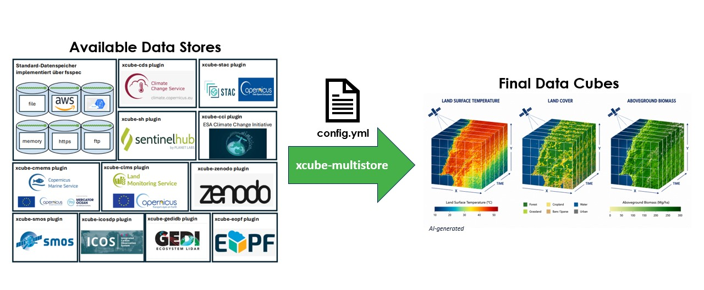

# Data access with Xcube

[xcube](https://xcube.readthedocs.io/en/latest/) is an open-source Python framework for working with Earth Observation data as analysis-ready data cubes. In this hackathon, it connects data sources to the analysis you run in [DeepESDL](../0_Introduction/Workspace/workspace.md).

You do not need to learn every xcube component before starting. The useful mental model is:

1. **Use a data store** to find and open a dataset.
2. **Subset and prepare it** for your question—for example by variable, area, period, projection, or resolution.
3. **Combine and harmonize multiple datasets** with xcube-multistore.
4. **Analyse and visualise** the resulting cube in a notebook.

## Use xcube data stores

xcube data stores provide one interface for datasets held in different services, formats, and storage systems. A store can return an `xarray.Dataset` or another suitable data object while hiding source-specific access details. Data are often loaded lazily, so you can work with datasets larger than memory.

For finding and opening data, the main operations are:

- `list_data_ids()` to enumerate available datasets;
- `describe_data(data_id)` to inspect dataset metadata;
- `search_data(...)` to find datasets using their metadata;
- `get_open_data_params_schema(data_id)` to check the supported open parameters; and
- `open_data(data_id, ...)` to open a dataset.

Mutable stores, such as the `file` and `s3` stores, can also write data. Both support formats such as Zarr and NetCDF. Prefer **Zarr** for regular data-cube outputs because it supports chunked, cloud-friendly access. Use local storage only for small explorations; use the shared team S3 storage by default for outputs you want to retain or share.

The main write-store operations are:

- `write_data(dataset, data_id, ...)` to write a dataset.
- `delete_data(data_id)` to permanently delete a dataset—use this with care.

For the full interface, see the [xcube data-access documentation](https://xcube.readthedocs.io/en/latest/dataaccess.html). The [DeepESDL data guide](https://earthsystemdatalab.net/guide/data/) describes data available on the platform.

## Start with DeepESDL examples

DeepESDL provides both pre-generated cubes in object storage and on-demand access through xcube data stores. Start with a ready-to-run example in the [DeepESDL notebook catalogue](https://earthsystemdatalab.net/guide/jupyterlab/notebooks/).

Some examples for data access:

- [Access Sentinel-2 data from the Copernicus Data Space Ecosystem](https://earthsystemdatalab.net/guide/jupyterlab/notebooks/xcube-datastores/Access_Sentinel2_data_from_CDSE/)
- [Access data from Zenodo](https://earthsystemdatalab.net/guide/jupyterlab/notebooks/xcube-datastores/Access_data_from_Zenodo/)

Some examples of how to use shared team storage:

- [Save a datacube to your team storage](https://earthsystemdatalab.net/guide/jupyterlab/notebooks/team-storage/Save_cube_to_team_storage/)
- [How to upload files to shared team S3 storage](https://earthsystemdatalab.net/guide/jupyterlab/notebooks/team-storage/Upload_files_to_shared_team_s3_storage/)

## Explore and visualise datasets

After saving a dataset to team storage, you can use the built-in xcube Viewer to inspect it interactively. You can work with the viewer directly in a notebook. A deployed example is the [DeepESDL Data Viewer](https://viewer.earthsystemdatalab.net/). The [Visualise data with xcube Viewer](https://earthsystemdatalab.net/guide/jupyterlab/notebooks/generic-notebooks/Visualise_data_with_xcube_viewer/) notebook shows how to open a dataset and create an interactive visualisation.

For more customised visualisations, you can also create your own plots and dashboards using Python libraries such as Matplotlib and Plotly. 

## Combine data with xcube-multistore

For questions that require several sources, [xcube-multistore](https://xcube-dev.github.io/xcube-multistore/) creates a multi-source data store with a unified data model. It builds on xcube data-store plugins and [xcube-resampling](https://xcube-dev.github.io/xcube-resampling/) to make data fusion more transparent and reproducible through configuration.

Typical workflow:

1. Access one or more datasets through xcube data stores.
2. Harmonise them by subsetting, resampling, or reprojecting them as needed.
3. Optionally fuse them into a single cube, or keep a catalogue of aligned datasets.

The result is either one data cube on a consistent grid or a catalogue of separate, consistently described datasets.

For a concrete workflow, start with the [data-extraction example](https://xcube-dev.github.io/xcube-multistore/examples/example2/data_extraction/) and use the [how-to guides](https://xcube-dev.github.io/xcube-multistore/howto/) to adapt the configuration.

## Summary of resources

- [xcube data-store framework](https://xcube.readthedocs.io/en/latest/dataaccess.html)
- [xcube-multistore documentation](https://xcube-dev.github.io/xcube-multistore/)
- [Available xcube-multistore data stores](https://xcube-dev.github.io/xcube-multistore/data/)
- [EO-LINCS guide to xcube-multistore](https://www.eo-lincs.org/xcube-multistore.html)
- [DeepESDL example notebooks](https://earthsystemdatalab.net/guide/jupyterlab/notebooks/)
- [NoR webinar: the xcube ecosystem](https://www.youtube.com/watch?v=ClGl9nk5K04&list=PLvT7fd9OiI9Ws9QtfIxJjUM-RgQbpkpuJ&index=6): end-to-end example of data access, manipulation, persistance, and exploration/ visualization.
- [EOPF webinar: xcube-eopf plugin](https://www.youtube.com/watch?v=w4_KPUtWZ4w): end-to-end example for new EOPF Sentinel-2 Zarr Samples.  
